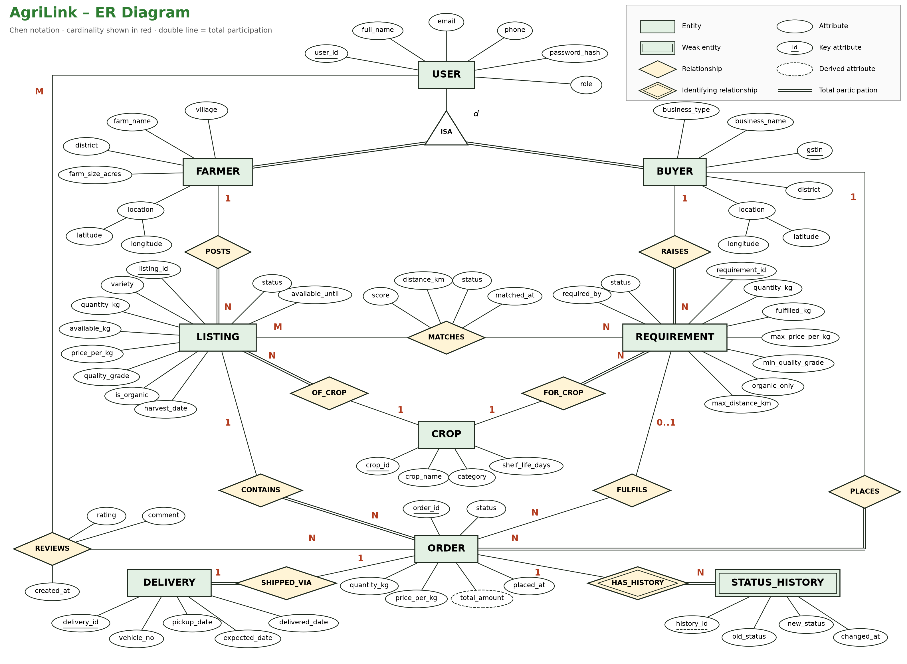

# AgriLink

**A quality-aware, direct farm-to-business agricultural marketplace.**

Farmers list produce; businesses (processors, hotels, retailers, exporters) post what they need. AgriLink matches the two on price, quantity, distance, freshness and crop-specific quality, then lets the buyer order in one safe transaction.

The matching, ordering and business rules live in the database: MySQL stored procedures, triggers, views and a scheduled event. MongoDB holds the flexible, per-crop quality data and the vector embeddings for meaning-based search.


## Features

- **Supply–demand matching in SQL.** The `sp_find_matches` procedure filters listings (crop, price, grade, organic, distance, freshness) and scores each one out of 100. It uses a geographic distance function, a `LATERAL` join and `RANK() OVER`.
- **Quality-aware ranking.** Each crop has its own quality attributes (tomato: ripeness, Brix, defects; rice: moisture, broken grains). Buyers set limits, and MongoDB checks every match against them, showing ✓ meets spec or ✗ misses spec with the reasons.
- **Safe ordering.** `sp_place_order` runs as one transaction with `SELECT … FOR UPDATE` row locks and full rollback on any error, so stock cannot be oversold.
- **Rules enforced by triggers.** Six triggers handle:
  - the order lifecycle (PLACED → CONFIRMED → SHIPPED → DELIVERED)
  - automatic SOLD_OUT
  - stock returned on cancel
  - delivery tracking
  - an audit history of every status change
  - reviews allowed only after delivery
- **Semantic search.** "potatoes for making chips" finds the Kufri Chipsona listing. Text is embedded locally with all-MiniLM-L6-v2 (384 dimensions), and cosine similarity is computed inside a MongoDB aggregation pipeline. No API key is needed.
- **Dashboards from SQL views.** These cover farmer earnings, buyer spend, and supply vs demand per crop.

## Tech stack

| Layer | Technology |
|---|---|
| Relational database | MySQL 8 (InnoDB) |
| Document / vector data | MongoDB 8+ |
| Embeddings | `@huggingface/transformers` with Xenova/all-MiniLM-L6-v2, running locally on ONNX |
| Web app | Next.js 15 (App Router, server actions), React 19, TypeScript, Tailwind CSS 4 |
| Auth | bcrypt password hashes and an HMAC-signed session cookie |
| Packaging | Docker Compose |

## Quick start with Docker

Requires Docker Desktop.

```bash
git clone https://github.com/sriranga-bharadwaj/agrilink.git
cd agrilink
docker compose up --build
```

Open http://localhost:3000. The first run builds the image, creates both databases and loads sample data, which takes a few minutes.

| Command | Effect |
|---|---|
| `docker compose up -d` | Start in the background |
| `docker compose down` | Stop; data is kept |
| `docker compose down -v` | Stop and delete all data; the next `up` re-seeds |

The database ports are not published, so this runs alongside a local MySQL or MongoDB. To use a different app port, set it first, e.g. `APP_PORT=3001 docker compose up`.

### Demo accounts

Every demo account uses the password `password123`.

| Role | Email |
|---|---|
| Buyer | `procure@freshbite.test` (FreshBite Foods, tomato and potato requirements) |
| Farmer | `ramesh@agrilink.test` (Gowda Tomato Farm) |
| Farmer | `kavitha@agrilink.test` (Malnad Greens: potato, banana) |

The sample data has 6 farmers, 4 buyers, 10 crops, 14 listings and 6 requirements.

**Try this:**
1. Log in as the buyer → **Tomato** requirement → see the ranked matches.
2. Order 1,500 kg from #1, then try 800 kg more. The second order is refused with "Only 500.00 kg available" and nothing is changed.
3. Log in as `ramesh@agrilink.test` → Confirm → Mark shipped → Mark delivered.

## Running without Docker

Requires MySQL 8, MongoDB and Node.js 24.

1. As MySQL root, run `database/mysql/00_setup_root.sql`. It creates the `agrilink` database and user and enables the event scheduler.
2. In `web/`, run `npm install`, then copy `.env.example` to `.env.local` and set `SESSION_SECRET`.
3. From the project root, build all tables, routines and sample data in both databases. This also resets them:
   ```bash
   powershell -ExecutionPolicy Bypass -File database\mysql\run_all.ps1
   ```
4. In `web/`, run `npm run dev` and open http://localhost:3000.

## Database design

| ER diagram (Chen notation) | Relational schema |
|---|---|
|  |  |

**MySQL** (`database/mysql/`)

| File | Contents |
|---|---|
| `01_schema.sql` | 11 tables with primary/foreign keys, UNIQUE and CHECK constraints, ENUMs, a stored generated column, and indexes |
| `02_functions_triggers.sql` | `fn_grade_rank`, `fn_distance_km` (`ST_Distance_Sphere`), and 6 triggers |
| `03_procedures.sql` | `sp_find_matches`, `sp_place_order`, `sp_expire_stale`, and the daily event `ev_expire_stale` |
| `04_views.sql` | 6 reporting views |
| `05_seed.sql` | Sample data |
| `06_demo.sql` | SQL walkthrough with deliberate errors |
| `07_show_schema.sql` | Queries that list tables, keys, relationships, constraints and routines |

**MongoDB** (`web/scripts/mongodb/`) has three collections:

- `crop_quality_specs`, `listing_quality` and `requirement_specs`, each with a `$jsonSchema` validator.
- Indexes: unique, compound, wildcard (`attributes.$**`), multikey and text.
- Each listing and requirement document shares its id with the MySQL row. If the MongoDB write fails, the MySQL insert is undone.

## Screenshots

| Marketplace semantic search | Buyer dashboard | Farmer dashboard |
|---|---|---|
|  |  |  |

## Project structure

```
database/mysql/        schema, triggers, procedures, views, seed and demo SQL
docs/diagrams/         ER and relational schema diagrams (+ the scripts that draw them)
docs/screenshots/      app screenshots
web/                   Next.js app
  src/app/             pages (market, farmer, buyer, login, signup) and server actions
  src/lib/             MySQL pool, MongoDB client, session, embeddings, quality helpers
  scripts/mongodb/     collection setup, seed data, demo commands
docker-compose.yml     MySQL + MongoDB + app
```

A full written explanation of the design, with walkthroughs of what happens in each scenario, is in `AgriLink-Project-Explanation.docx`.
