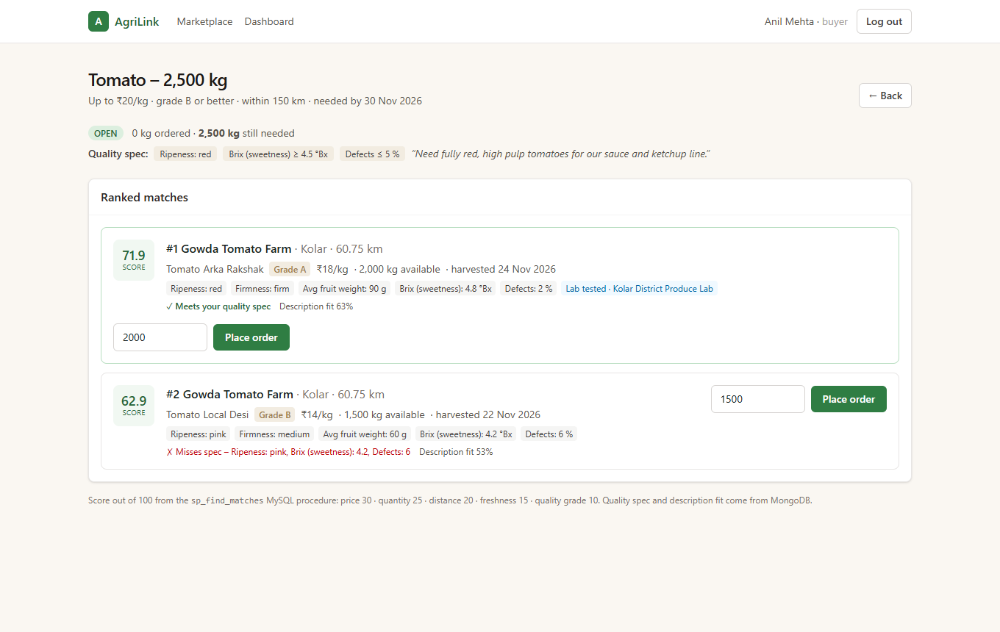
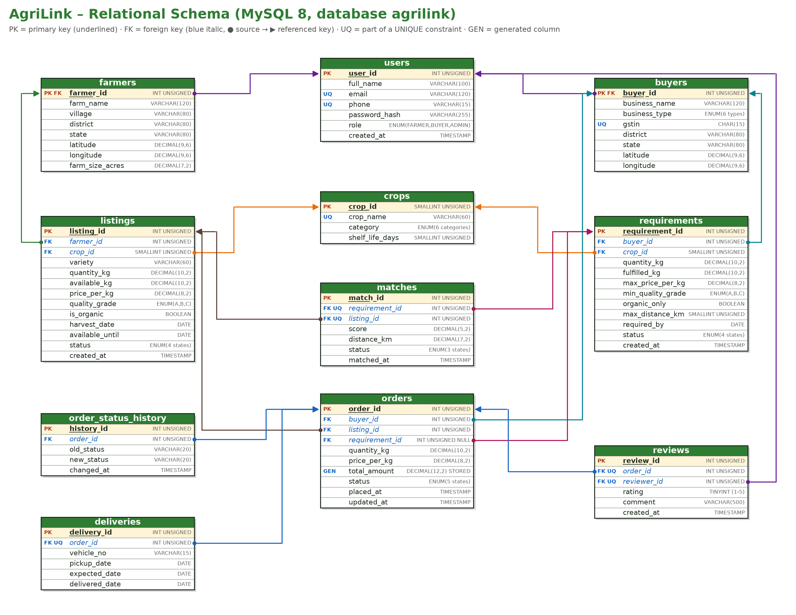
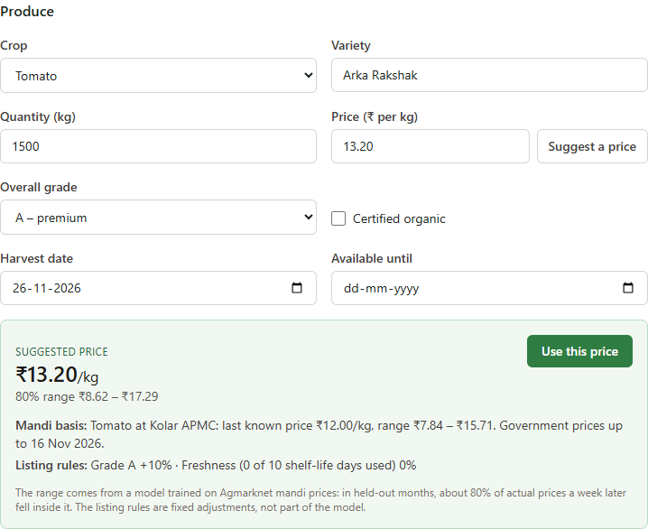
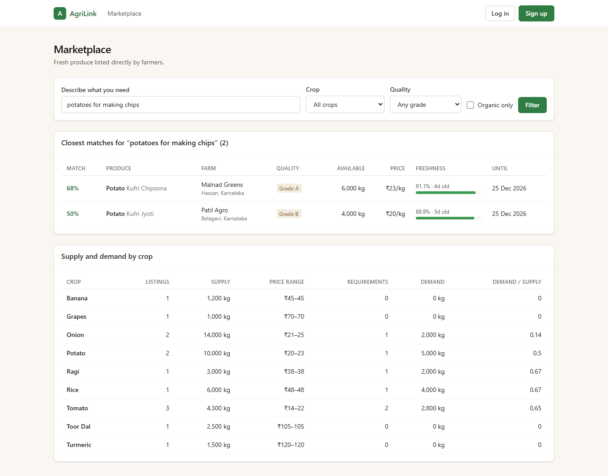
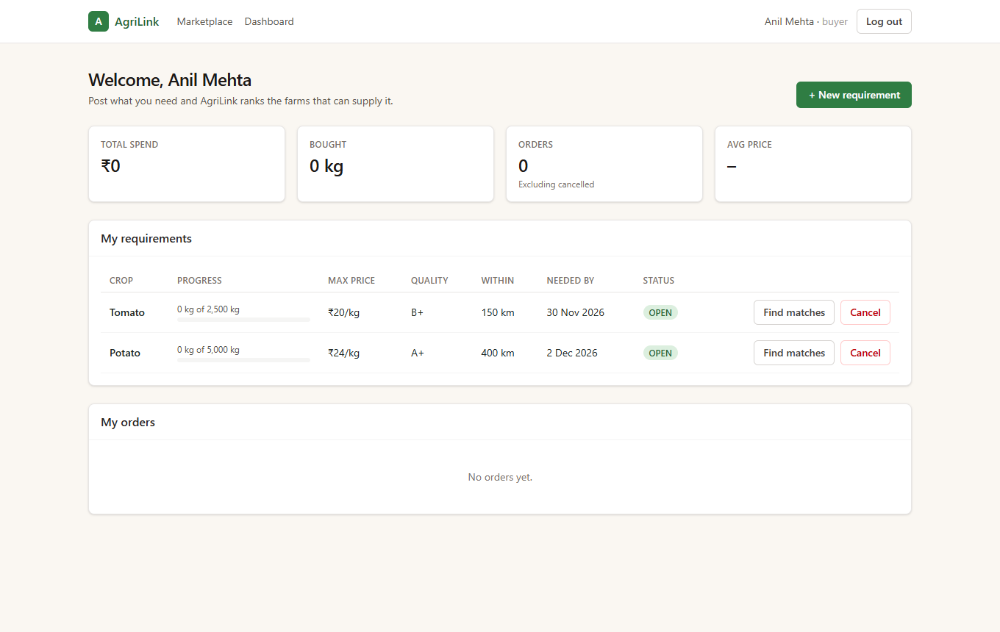
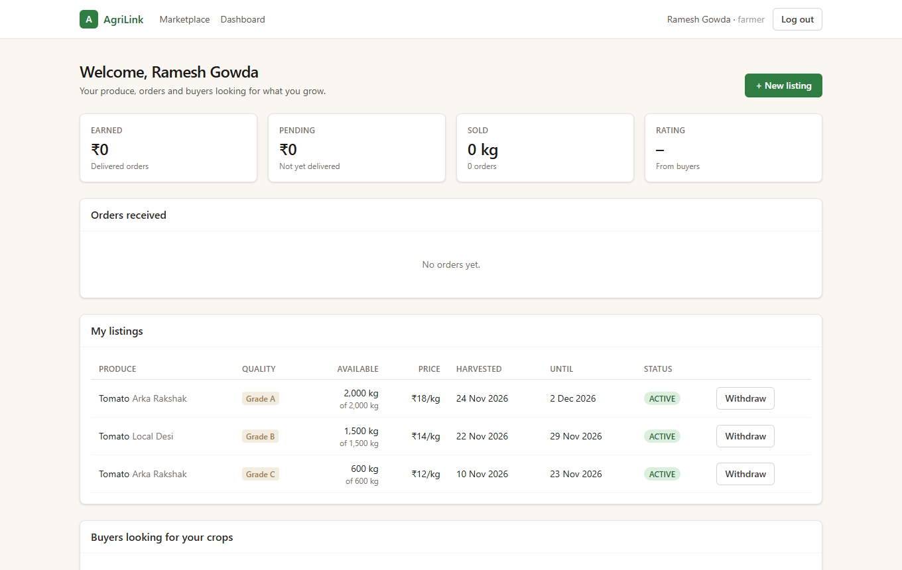

# AgriLink

[](https://github.com/sriranga-bharadwaj/agrilink/actions/workflows/ci.yml)

**A quality-aware, direct farm-to-business agricultural marketplace.**

Farmers list produce; businesses (processors, hotels, retailers, exporters) post what they need. AgriLink matches the two on price, quantity, distance, freshness and crop-specific quality, then lets the buyer order in one safe transaction.

The matching, ordering and business rules live in the database: MySQL stored procedures, triggers, views and a scheduled event. MongoDB holds the flexible, per-crop quality data and the vector embeddings for meaning-based search.



## Features

- **Supply–demand matching in SQL.** The `sp_find_matches` procedure filters listings (crop, price, grade, organic, distance, freshness) and scores each one out of 100. It uses a geographic distance function, a `LATERAL` join and `RANK() OVER`.
- **Quality-aware ranking.** Each crop has its own quality attributes (tomato: ripeness, Brix, defects; rice: moisture, broken grains). Buyers set limits, and MongoDB checks every match against them, showing ✓ meets spec or ✗ misses spec with the reasons.
- **Safe ordering.** `sp_place_order` runs as one transaction with `SELECT … FOR UPDATE` row locks and full rollback on any error, so stock cannot be oversold.
- **Rules enforced by triggers.** Six triggers handle:
  - the order lifecycle (PLACED → CONFIRMED → SHIPPED → DELIVERED)
  - automatic SOLD_OUT
  - stock returned on cancel
  - delivery tracking
  - an audit history of every status change
  - reviews allowed only after delivery
- **Semantic search.** "potatoes for making chips" finds the Kufri Chipsona listing. Text is embedded locally with all-MiniLM-L6-v2 (384 dimensions), and cosine similarity is computed inside a MongoDB aggregation pipeline. No API key is needed.
- **Dashboards from SQL views.** These cover farmer earnings, buyer spend, and supply vs demand per crop.
- **Price suggestion from government market data.** A farmer gets a suggested price plus a calibrated 80% range, based on Agmarknet mandi prices for their own district, with honestly reported accuracy. See [AI price suggestion](#ai-price-suggestion).

## Tech stack

| Layer | Technology |
|---|---|
| Relational database | MySQL 8 (InnoDB) |
| Document / vector data | MongoDB 8+ |
| Embeddings | `@huggingface/transformers` with Xenova/all-MiniLM-L6-v2, running locally on ONNX |
| Web app | Next.js 15 (App Router, server actions), React 19, TypeScript, Tailwind CSS 4 |
| Auth | bcrypt password hashes and an HMAC-signed session cookie |
| Packaging | Docker Compose |

## Quick start with Docker

Requires Docker Desktop.

```bash
git clone https://github.com/sriranga-bharadwaj/agrilink.git
cd agrilink
docker compose up --build
```

Open http://localhost:3000. The first run builds the image, creates both databases and loads sample data, which takes a few minutes.

| Command | Effect |
|---|---|
| `docker compose up -d` | Start in the background |
| `docker compose down` | Stop; data is kept |
| `docker compose down -v` | Stop and delete all data; the next `up` re-seeds |

The database ports are not published, so this runs alongside a local MySQL or MongoDB. To use a different app port, set `APP_PORT` first: `$env:APP_PORT=3001; docker compose up` in PowerShell, or `APP_PORT=3001 docker compose up` in bash.

### Demo accounts

Every demo account uses the password `password123`.

| Role | Email |
|---|---|
| Buyer | `procure@freshbite.test` (FreshBite Foods, tomato and potato requirements) |
| Farmer | `ramesh@agrilink.test` (Gowda Tomato Farm) |
| Farmer | `kavitha@agrilink.test` (Malnad Greens: potato, banana) |

The sample data has 6 farmers, 4 buyers, 10 crops, 14 listings and 6 requirements.

**Try this:**
1. Log in as the buyer → **Tomato** requirement → see the ranked matches.
2. Order 1,500 kg from #1, then try 800 kg more. The second order is refused with "Only 500.00 kg available" and nothing is changed.
3. Log in as `ramesh@agrilink.test` → Confirm → Mark shipped → Mark delivered.
4. Still as Ramesh: **+ New listing** → Tomato → **Suggest a price**.

## Running without Docker

Requires MySQL 8, MongoDB and Node.js 24.

1. As MySQL root, run `database/mysql/00_setup_root.sql`. It creates the `agrilink` database and user and enables the event scheduler.
2. In `web/`, run `npm install`, then copy `.env.example` to `.env.local` and set `SESSION_SECRET`.
3. From the project root, build all tables, routines and sample data in both databases. This also resets them:
   ```bash
   powershell -ExecutionPolicy Bypass -File database\mysql\run_all.ps1
   ```
4. In `web/`, run `npm run dev` and open http://localhost:3000.

## Database design

| ER diagram (Chen notation) | Relational schema |
|---|---|
|  |  |

**MySQL** (`database/mysql/`)

| File | Contents |
|---|---|
| `01_schema.sql` | 11 marketplace tables plus `mandi_prices` (government prices for suggestions), with primary/foreign keys, UNIQUE and CHECK constraints, ENUMs, a stored generated column, and indexes |
| `02_functions_triggers.sql` | `fn_grade_rank`, `fn_distance_km` (`ST_Distance_Sphere`), and 6 triggers |
| `03_procedures.sql` | `sp_find_matches`, `sp_place_order`, `sp_expire_stale`, and the daily event `ev_expire_stale` |
| `04_views.sql` | 6 reporting views |
| `05_seed.sql` | Sample data |
| `06_demo.sql` | SQL walkthrough with deliberate errors |
| `07_show_schema.sql` | Queries that list tables, keys, relationships, constraints and routines |

**MongoDB** (`web/scripts/mongodb/`) has three collections:

- `crop_quality_specs`, `listing_quality` and `requirement_specs`, each with a `$jsonSchema` validator.
- Indexes: unique, compound, wildcard (`attributes.$**`), multikey and text.
- Each listing and requirement document shares its id with the MySQL row. If the MongoDB write fails, the MySQL insert is undone.

## Automated tests

There are 43 tests, built on Node's built-in test runner:

| File | Tests | What it covers |
|---|---|---|
| [`mysql.test.mjs`](web/tests/mysql.test.mjs) | 16 | Matching filters and ranking. Ordering: stock, price copy, generated total, oversell and rollback, requirement fill, ownership and crop checks. All lifecycle triggers: illegal jumps, immutable quantity, delivery tracking, audit history, stock returned on cancel. Review rules, CHECK constraints and the expiry procedure. |
| [`mongo.test.mjs`](web/tests/mongo.test.mjs) | 6 | `$jsonSchema` rejections, the unique link to MySQL, wildcard-index use, the buyer quality-spec filter, cosine similarity, and a semantic-search query |
| [`quality.test.mjs`](web/tests/quality.test.mjs) | 9 | Quality-constraint logic and form parsing |
| [`pricing.test.mjs`](web/tests/pricing.test.mjs) | 7 | Price suggestion. **Parity:** the TypeScript features from the CSV and from MySQL match Python to 1e-9, and ONNX in Node matches the exported predictions. **Leakage guards:** prices dated after *t − 7* never change a suggestion, on the live SQL path or in the feature builder. Also a Kolar tomato suggestion, and the message for crops without data. |
| [`price-adjust.test.mjs`](web/tests/price-adjust.test.mjs) | 5 | Listing rules (grade, organic, freshness, demand) and range scaling |

Each database test creates its own rows and deletes them afterwards, so the suite can run repeatedly against the sample data. Every "blocked" case also checks that nothing changed.

```bash
docker compose -p agrilink-test run --rm web npm test   # throwaway databases
docker compose -p agrilink-test down -v
```

Without Docker, run `npm run test:local` in `web/` against the databases built by `run_all.ps1`.

GitHub Actions ([`ci.yml`](.github/workflows/ci.yml)) runs the same two commands on every push and pull request. The image build also lints and type-checks the app.

## AI price suggestion

On **New listing**, **Suggest a price** gives the farmer a price and an 80% range based on real government wholesale prices for their district.



### How it works

**Data:**
- Agmarknet daily mandi prices from [data.gov.in](https://data.gov.in/resource/variety-wise-daily-market-prices-data-commodity).
- About 1.5 million rows, 2002 to November 2026, from 11 districts in Karnataka and Maharashtra.
- A coverage gate decided which crops have enough continuous history: **Tomato, Onion, Potato, Rice (and Broken rice) and Groundnut** pass.
- Ragi, Banana, Grapes, Turmeric and Toor Dal don't, and the app says so instead of guessing.

**Model:**
- Gradient boosting forecasts the mandi price **7 days ahead**, using only prices dated on or before *t − 7*.
- It is trained on 2015 – May 2026, with a separate calibration block and a test block (Aug–Nov 2026) scored once.
- Ranges come from 10%/90% quantile models conformalized on the calibration block (CQR).

**Serving:**
- Python exports the models to ONNX, and Next.js runs them with `onnxruntime-node`.
- The features are recomputed live from the `mandi_prices` table, and tests prove they match Python exactly.

### Honest results (test block, 5,076 rows)

| | Error, ₹/kg (MAPE) |
|---|---|
| Gradient boosting model | 4.41 (15%) |
| Last known price | 4.29 (16%) |
| 30-day median | 4.79 (16%) |
| Same period last year | 9.14 (29%) |
| Ridge regression | 4.87 (16%) |

**Accuracy:**
- A per-series bootstrap found **no product where the model clearly beats the best simple baseline**.
- The baseline is clearly better for Onion and Broken rice.

**Ranges:**
- The calibrated 80% ranges contained **83% of actual prices** overall, between 76% and 92% depending on the product.
- They are wide: the median width is about half the price, which is realistic for a week ahead.

**What the app shows (the user's decision after seeing these results):**
- The **suggested price** is a simple baseline: last known price for Onion and Tomato, 30-day median for the rest, chosen per product on the calibration block.
- The **range** is the model's calibrated range.
- On the test block this mix had a ₹4.16/kg error with 83% coverage. Because the choice was made after the test was scored, that figure is descriptive, not an unbiased estimate.
- Fixed listing rules (grade, organic, freshness, demand) then adjust the price. They are shown separately and are not part of the model.

Full reports, cleaning rules and reproduction steps are in [`ml/README.md`](ml/README.md). Data: Agmarknet / DMI, Ministry of Agriculture & Farmers Welfare, under the Government Open Data License – India.

## Performance and correctness tests

Both scripts run inside a throwaway Docker project, so they never touch your normal data. They clean up their own rows, and `down -v` removes the project afterwards.

```bash
docker compose -p agrilink-bench run --rm web node scripts/bench/load-test.mjs
docker compose -p agrilink-bench run --rm web node scripts/bench/query-benchmark.mjs
docker compose -p agrilink-bench down -v
```

Results below are from one run on an Intel Core i5-12450H laptop (16 GB RAM, Docker Desktop with 12 CPUs / 8 GB), MySQL 8.0.46.

### Concurrent orders: no overselling

[`load-test.mjs`](web/scripts/bench/load-test.mjs) creates a listing with 1,000 kg of stock. It opens 100 separate MySQL connections and fires 100 simultaneous 25 kg purchases at it, which is 2,500 kg of demand for 1,000 kg of stock. Exactly 40 must succeed. Each round checks four things:
- the number of successes
- stock never below 0
- kg sold + kg remaining = 1,000
- one audit-history row per order

As a control, it reruns the same harness with a naive read-then-write that has no row lock.

| Purchase path | Rounds | Calls | Succeeded per round | Oversold | Checks |
|---|---|---|---|---|---|
| `sp_place_order` (`SELECT … FOR UPDATE`, rollback on error) | 5 | 500 | 40 (60 refused "Only X kg available") | **0 kg** | all passed, no deadlocks or timeouts |
| Naive read-then-write (control) | 5 | 500 | 100 | 1,500 kg per round | failed |

The control shows the harness really races: every naive request read the same 1,000 kg. The row lock is what keeps the stock correct.

### Matching query: composite index

[`query-benchmark.mjs`](web/scripts/bench/query-benchmark.mjs) loads 100,000 synthetic listings with a fixed, seeded distribution:
- 10 crops and 6 farms
- 20% ACTIVE, the rest sold out, expired or withdrawn
- prices from ₹10 to ₹40/kg and grades A/B/C

It then times the whole `CALL sp_find_matches(1)`: delete old suggestions, filter and score, insert matches, return the ranking. Each setup gets 3 warm-up calls and then 15 measured calls (median shown). Every setup returns the same 190 matches.

| Index on `listings` | Median | Min–max | MySQL plan for the filter | Rows examined (est.) |
|---|---|---|---|---|
| `idx_listings_match (crop_id, status, price_per_kg)` | **36.7 ms** | 33.2–49.5 ms | range scan | **624** |
| `crop_id` only (what the foreign key alone gives) | 63.5 ms | 51.5–86.5 ms | ref lookup | 10,241 |
| None (full table scan) | 56.5 ms | 46.3–122.5 ms | full scan | 99,946 |

With the composite index, MySQL plans to read about **16× fewer rows** than with the `crop_id` index and **160× fewer** than a full scan. The whole procedure gets **1.7× faster**. The rest of its time goes to scoring, the distance function and writing the 190 match rows, which the index does not affect.

## Screenshots

| Marketplace semantic search | Buyer dashboard | Farmer dashboard |
|---|---|---|
|  |  |  |

## Project structure

```
database/mysql/        schema, triggers, procedures, views, seed and demo SQL
docs/diagrams/         ER and relational schema diagrams (+ the scripts that draw them)
docs/screenshots/      app screenshots
ml/                    price model pipeline (Python): data checks, dataset, training, evaluation, ONNX export, reports
web/                   Next.js app
  src/app/             pages (market, farmer, buyer, login, signup) and server actions
  src/lib/             MySQL pool, MongoDB client, session, embeddings, quality helpers, price suggestion
  models/              exported ONNX price models and their spec
  data/                cleaned mandi prices loaded into MySQL
  scripts/mongodb/     collection setup, seed data, demo commands
  scripts/mysql/       mandi price loader
docker-compose.yml     MySQL + MongoDB + app
```

A full written explanation of the design, with walkthroughs of what happens in each scenario, is in `AgriLink-Project-Explanation.docx`.
